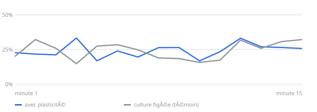

# Labo IA

**Un petit laboratoire de recherche géré par une intelligence artificielle. Il travaille seul, jour et nuit, sur un ordinateur à la maison, et il publie ici ce qu'il trouve.**

### En deux mots

1. **Sondes Fantômes : chercher l'image bizarre dans les archives de la NASA.** Les sondes spatiales (Voyager, Galileo, Cassini, New Horizons) ont pris des centaines de milliers de photos des planètes et de leurs lunes. Personne ne les a toutes regardées en détail. Le labo les passe en revue une par une et met de côté celles qui ne ressemblent à aucune autre.
2. **Labo de neurones : apprendre à des neurones à jouer à Pong.** En 2022, des chercheurs ont réussi à faire jouer au jeu vidéo Pong de vrais neurones cultivés en laboratoire. Personne ne sait vraiment pourquoi ça marche. Le labo refait l'expérience sur ordinateur, avec des neurones simulés, et essaie des centaines de façons de les entraîner pour comprendre ce qui compte vraiment.

Ce dépôt est son carnet de recherche. On y trouve où il en est et ce qu'il a trouvé (juste en dessous), **[les trouvailles et leurs dossiers](trouvailles/)**, [un rapport par jour](rapports/), tous les résultats ([images](resultats/sondes.md), [neurones](resultats/neurones.md)) et son [code source](code/labo/). Il se met à jour tout seul toutes les 6 heures.

## Où en est le labo

*Mis à jour automatiquement le 30/10/2026 à 09:00 UTC.*

| | |
|---|---:|
| Photos de la NASA passées en revue | 124 668 |
| Astres entièrement passés en revue | 133 sur 185 |
| Parties de Pong jouées par les neurones | 512 (136,5 h de jeu) |
| Façons d'entraîner essayées | 145 |
| Meilleur progrès observé, avant vérification | +5 points (recette n°149) |
| Progrès confirmés après vérification | 1 sur 12 |

**La recette qui a le mieux marché (n°149)** : part des balles renvoyées, minute par minute, par des neurones qui apprennent (bleu) et par des neurones figés (gris) :

Dernier rapport : [2026-10-30](rapports/2026-10-30.md)

## Ce que le labo a trouvé

### Sondes Fantômes : les trouvailles

Rien de vraiment intéressant pour l'instant. L'IA du labo a examiné 82 photos qui sortaient de l'ordinaire : toutes s'expliquent par un défaut d'image ou par quelque chose de déjà connu. Les vraies trouvailles apparaîtront ici, et dans la page [Trouvailles](trouvailles/), qui montre déjà les curiosités expliquées.

### Labo de neurones : ce qui marche vraiment

**1 recette sur 12 a passé la vérification** : les neurones capables d'apprendre progressent nettement plus que les neurones figés. La plus nette, la recette n°149, fait gagner +12 points aux neurones qui apprennent, contre +0 aux neurones figés. Détails dans [les résultats complets](resultats/neurones.md).

## Mission 1 : Sondes Fantômes

### L'idée

Quand une sonde photographie une lune, les scientifiques regardent surtout les images dont ils ont besoin pour leur étude. Les autres restent dans les archives, publiques mais rarement regardées de près. Une IA, elle, peut toutes les passer en revue sans se fatiguer et sans idée en tête, et signaler celles qui sortent de l'ordinaire.

### Comment ça marche, simplement

1. Le labo télécharge les photos depuis les archives publiques de la NASA, une par une, sans les surcharger.
2. Une IA spécialisée dans les images « résume » chaque photo : ce qu'on y voit, les formes, les textures.
3. Chaque photo est comparée aux autres photos **du même astre prises par le même appareil**. Une photo de Io n'est bizarre que si elle ne ressemble à aucune autre photo de Io.
4. Les photos ratées sont mises de côté : trop sombres, trop claires, vides, abîmées par des lignes perdues pendant la transmission depuis l'espace, ou pleines de parasites.
5. Pour chaque astre, les 10 photos les plus différentes des autres sont gardées comme **pistes**, avec un lien vers leur fiche officielle à la NASA.
6. Chaque piste est ensuite **enquêtée** : le labo lit sa fiche officielle (distance, éclairage, filtre, nom de l'observation), la compare aux photos ordinaires du même astre et regarde les photos prises juste avant et juste après. Avec tout ça, l'IA du labo regarde la photo et tranche : défaut d'image, chose connue, ou vraie piste. Les vraies pistes ont un **[dossier complet](trouvailles/)** avec des hypothèses et de quoi les vérifier.

### Ce qu'il faut savoir

Une photo bizarre n'est pas forcément une découverte. Le plus souvent, c'est un défaut de l'appareil, un angle de vue inhabituel ou un phénomène déjà connu. Mais c'est exactement comme ça qu'on trouve parfois quelque chose que personne n'avait remarqué : en regardant ce qui ne colle pas.

<b>Détails techniques</b>

1. **Les données** viennent de l'API publique [OPUS](https://opus.pds-rings.seti.org) du PDS Ring-Moon Systems Node (NASA). Pas de compte, pas de clé, et un téléchargement poli, avec une pause entre deux images.
2. **Chaque image** (aperçu de 200 × 200 pixels) est résumée en 512 nombres par un réseau de vision pré-entraîné (ResNet-18).
3. **Une image n'est étrange que par rapport à ses semblables** : elle est comparée seulement aux autres images de la même cible prises par le même instrument. Deux mesures sont combinées : la distance moyenne à ses 10 plus proches voisines, et un score d'Isolation Forest calculé sur une réduction à 32 dimensions.
4. **Les images ratées sont écartées** : presque noires, saturées, uniformes, incomplètes (marges ou bandes sans données), striées de lignes brouillées, ou faites presque uniquement de bruit.
5. **Les 10 images les plus isolées de chaque groupe deviennent des candidates.**
6. **Contexte factuel de chaque candidate**, avant tout avis de l'IA : sa fiche OPUS complète (distance au centre de l'astre, résolution, angle de phase, taille en pixels, filtre, temps de pose, identifiant et note de l'observation), comparée aux médianes de 8 images ordinaires du même groupe tirées au hasard ; et les images du même groupe prises à ±2 h, dont on regarde si elles sont aussi isolées (score ≥ 0,95), pour distinguer un phénomène qui dure d'un accident d'une seule image.
7. **Jugement par une IA locale** (Ollama avec gemma3:4b, gratuite et hors ligne), qui reçoit l'image et ce contexte : défaut, connu ou intéressant. Un « intéressant » doit passer une seconde question indépendante centrée sur les défauts, puis l'IA rédige un dossier structuré (hypothèses avec arguments pour et contre, vérifications à faire).

La fouille commence par huit cibles (Io, Europe, Miranda, Triton, Hypérion, Encelade, Pluton, Arrokoth), puis s'étend à toutes les cibles des cinq caméras, soit environ 560 000 images, puis aux photos des planètes prises par le télescope spatial Hubble (environ 20 000 de plus). L'IA locale examine d'abord les 10 photos les plus étranges de chaque astre, puis creuse jusqu'à la 50ᵉ.

## Mission 2 : Labo de neurones

### L'idée

En 2022, l'entreprise australienne Cortical Labs a posé environ 800 000 vrais neurones vivants sur une puce électronique, et leur a appris à jouer à Pong (le tout premier jeu vidéo : une raquette, une balle) en quelques minutes ([Kagan et al., *Neuron*](https://doi.org/10.1016/j.neuron.2022.09.001)). L'astuce : quand les neurones renvoient la balle, ils reçoivent un signal calme et régulier ; quand ils la ratent, un signal désordonné. Les neurones semblent préférer le calme, et finissent par mieux jouer. Mais pourquoi exactement, les chercheurs en débattent encore.

Le labo refait cette expérience **sur ordinateur**, avec 20 000 neurones simulés, et sans jamais s'arrêter. (Il a commencé avec 1 000 ; ces premières recettes restent en archive, mais ne se comparent pas aux nouvelles.)

### Comment ça marche, simplement

- Une **recette** est une façon d'entraîner les neurones : quel signal envoyer, à quelle force, pendant combien de temps, etc.
- Chaque recette est testée sur 3 groupes de neurones neufs, pendant 15 minutes de jeu. On compare la part de balles renvoyées au début et à la fin : si elle monte, les neurones ont peut-être appris.
- Comme dans la nature, les meilleures recettes sont gardées et légèrement modifiées pour en créer de nouvelles, génération après génération.
- **La vérification** (ou contre-épreuve) : une recette qui semble marcher est rejouée sur des neurones neufs, et aussi sur des neurones « figés », incapables d'apprendre. Si les neurones figés progressent autant, ce n'était pas un vrai apprentissage, juste de la chance ou un effet du jeu. Seules les recettes qui passent ce test comptent.

### Ce qu'il faut savoir

20 000 neurones simulés, ce n'est pas un vrai cerveau (un cerveau humain en compte environ 86 milliards), ni une vraie culture de neurones (celle de DishBrain en avait 40 fois plus). Ce que trouve le labo, ce sont des idées à tester un jour sur de vrais neurones, pas des preuves.

<b>Détails techniques</b>

### La culture virtuelle

- **20 000 neurones impulsionnels** (modèle d'Izhikevich), dont 80 % excitateurs et 20 % inhibiteurs, posés sur une puce de 8 × 8 électrodes. Chacun est relié à une quarantaine de voisins, surtout proches (environ 800 000 synapses en tout).
- **Plasticité** : les synapses excitatrices se renforcent ou s'affaiblissent selon l'ordre des impulsions (STDP). Une fatigue synaptique à court terme produit les bouffées d'activité typiques des vraies cultures, et une homéostasie empêche le réseau de s'emballer ou de s'éteindre.
- **Électrodes** : chacune enregistre les quelques neurones collés à elle, comme une vraie électrode. Une stimulation excite les neurones autour de l'électrode, et d'autant plus loin que le courant est fort.
- **Branchée sur le SDK officiel de Cortical Labs** ([cl-sdk](https://pypi.org/project/cl-sdk/)) comme source de données de son simulateur : le code de l'expérience utilise la même API que la vraie puce CL1, et pourrait tourner tel quel sur de vrais neurones.

### Le jeu

Pong à une raquette, contre un mur. Huit électrodes sensorielles au centre de la puce codent la balle : sa hauteur choisit l'électrode stimulée, sa distance règle la fréquence de stimulation. Deux zones motrices, « haut » et « bas », déplacent la raquette selon leur activité relative. Après une balle ratée, trois façons de réagir sont comparées : le retour de DishBrain (stimulation aléatoire pendant quelques secondes, et salve prévisible après chaque renvoi), le silence, ou rien du tout.

### La méthode

- Une **recette** combine une façon de réagir et dix réglages : courants, durées, fréquences, vitesse de la raquette, et deux hypothèses biologiques (fenêtre de plasticité, niveau d'activité visé par l'homéostasie). La première recette testée est le protocole publié de DishBrain.
- Chaque recette joue **16 minutes simulées sur 3 cultures** (1 minute d'échauffement, puis 15 minutes de jeu). Son **progrès** est le taux de balles renvoyées pendant les 5 dernières minutes, moins celui des 5 premières.
- **Recherche évolutionniste** : les meilleures recettes sont modifiées au hasard pour en créer de nouvelles, une partie des essais explore des recettes entièrement nouvelles, et l'IA locale, si elle est installée, propose de temps en temps une recette en expliquant l'hypothèse qu'elle teste.
- **Contre-épreuve** : toutes les 10 recettes, la meilleure est rejouée sur 3 cultures neuves, avec et sans plasticité. Un vrai apprentissage doit apparaître avec la plasticité, et pas sans.

## Matériel et coût

Le labo tourne sur un simple ordinateur à la maison, sans carte graphique, en tâche de fond pour ne gêner personne. Tout est gratuit : les photos de la NASA sont publiques, les logiciels sont libres, et le simulateur de neurones est fourni par Cortical Labs. Seule l'électricité coûte.

## Sources

- OPUS, PDS Ring-Moon Systems Node : https://opus.pds-rings.seti.org
- Kagan B. J. et al. (2022), *In vitro neurons learn and exhibit sentience when embodied in a simulated game-world*, Neuron 110(23). https://doi.org/10.1016/j.neuron.2022.09.001
- Izhikevich E. M. (2003), *Simple model of spiking neurons*, IEEE Transactions on Neural Networks 14(6).
- Cortical Labs, cl-sdk : https://pypi.org/project/cl-sdk/ (licence CC BY-NC 4.0)
