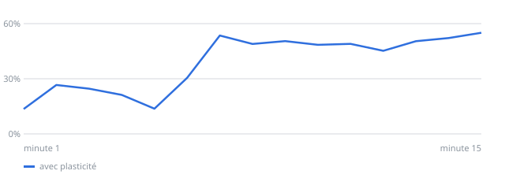

# Labo de neurones : recettes d'entraînement

*Mis à jour le 08/11/2026 à 09:03 UTC. Progrès = balles renvoyées pendant les 5 dernières minutes de jeu, moins les 5 premières, en points, en moyenne sur 3 cultures.*

## La meilleure recette, minute par minute

## Les 30 meilleures recettes (cultures de 20 000 neurones)

| n° | Protocole | Réglages | Début → fin | Progrès | Contre-épreuve |
|---:|---|---|---:|---:|---|
| 310 | retour prévisible / imprévisible (DishBrain) *variante de la n°184* | stimulation 0,83 µA de 7,77 à 28,87 Hz ; retour 1,46 µA, 0,91 s à 10,8 Hz, salve de 10 ; raquette ×3,59 ; STDP 38,34 ms ; homéostasie 3 Hz | 20 % → 53 % | **+33** | -2 avec plasticité, -0 sans : non reproduit |
| 333 | retour prévisible / imprévisible (DishBrain) *variante de la n°315* | stimulation 0,7 µA de 6,96 à 31,75 Hz ; retour 1,26 µA, 0,91 s à 10,8 Hz, salve de 9 ; raquette ×3,56 ; STDP 14,87 ms ; homéostasie 3 Hz | 18 % → 50 % | **+32** | -1 avec plasticité, -5 sans : non reproduit |
| 315 | retour prévisible / imprévisible (DishBrain) *variante de la n°158* | stimulation 0,7 µA de 6,96 à 34,59 Hz ; retour 1,46 µA, 0,91 s à 10,8 Hz, salve de 10 ; raquette ×3,25 ; STDP 14,87 ms ; homéostasie 3 Hz | 22 % → 53 % | **+31** | +2 avec plasticité, +6 sans : non reproduit |
| 384 | retour prévisible / imprévisible (DishBrain) *variante de la n°333* | stimulation 0,55 µA de 6,96 à 31,75 Hz ; retour 1,26 µA, 0,91 s à 10,8 Hz, salve de 13 ; raquette ×3,56 ; STDP 14,87 ms ; homéostasie 3 Hz | 20 % → 51 % | **+31** | – |
| 370 | retour prévisible / imprévisible (DishBrain) *variante de la n°333* | stimulation 1,05 µA de 6,96 à 31,75 Hz ; retour 1,26 µA, 0,91 s à 10,8 Hz, salve de 9 ; raquette ×3,56 ; STDP 24,42 ms ; homéostasie 3 Hz | 21 % → 52 % | **+31** | +1 avec plasticité, -4 sans : non reproduit |
| 232 | retour prévisible / imprévisible (DishBrain) *variante de la n°158* | stimulation 0,83 µA de 6,42 à 28,87 Hz ; retour 1,46 µA, 0,91 s à 10,8 Hz, salve de 10 ; raquette ×3,25 ; STDP 34,42 ms ; homéostasie 3 Hz | 20 % → 50 % | **+31** | -2 avec plasticité, -1 sans : non reproduit |
| 208 | retour prévisible / imprévisible (DishBrain) *variante de la n°184* | stimulation 0,83 µA de 6,96 à 27 Hz ; retour 1,46 µA, 0,91 s à 10,8 Hz, salve de 10 ; raquette ×3,64 ; STDP 52,13 ms ; homéostasie 3 Hz | 19 % → 50 % | **+31** | -0 avec plasticité, -3 sans : non reproduit |
| 372 | retour prévisible / imprévisible (DishBrain) *variante de la n°370* | stimulation 0,92 µA de 5,8 à 31,75 Hz ; retour 0,89 µA, 0,91 s à 10,8 Hz, salve de 9 ; raquette ×3,56 ; STDP 24,42 ms ; homéostasie 3 Hz | 19 % → 49 % | **+30** | -1 avec plasticité, +2 sans : non reproduit |
| 362 | retour prévisible / imprévisible (DishBrain) *variante de la n°333* | stimulation 0,7 µA de 6,96 à 34,65 Hz ; retour 1,15 µA, 0,91 s à 10,8 Hz, salve de 9 ; raquette ×3,69 ; STDP 14,87 ms ; homéostasie 3 Hz | 19 % → 49 % | **+30** | – |
| 158 | retour prévisible / imprévisible (DishBrain) *variante de la n°140* | stimulation 0,83 µA de 6,96 à 28,87 Hz ; retour 1,46 µA, 0,91 s à 10,8 Hz, salve de 10 ; raquette ×3,25 ; STDP 38,34 ms ; homéostasie 3 Hz | 20 % → 50 % | **+30** | -6 avec plasticité, -6 sans : non reproduit |
| 184 | retour prévisible / imprévisible (DishBrain) *variante de la n°158* | stimulation 0,83 µA de 6,96 à 28,87 Hz ; retour 1,46 µA, 0,91 s à 10,8 Hz, salve de 10 ; raquette ×3,25 ; STDP 38,34 ms ; homéostasie 3 Hz | 20 % → 50 % | **+30** | +7 avec plasticité, +4 sans : les cultures figées progressent autant |
| 250 | retour prévisible / imprévisible (DishBrain) *variante de la n°158* | stimulation 0,85 µA de 7,26 à 29,39 Hz ; retour 1,75 µA, 0,91 s à 10,8 Hz, salve de 10 ; raquette ×3,01 ; STDP 38,34 ms ; homéostasie 3 Hz | 19 % → 49 % | **+30** | +0 avec plasticité, -2 sans : non reproduit |
| 352 | retour prévisible / imprévisible (DishBrain) *variante de la n°184* | stimulation 0,83 µA de 6,6 à 28,87 Hz ; retour 1,46 µA, 0,91 s à 10,8 Hz, salve de 10 ; raquette ×3,25 ; STDP 32,08 ms ; homéostasie 2,91 Hz | 22 % → 52 % | **+30** | -11 avec plasticité, -4 sans : non reproduit |
| 209 | retour prévisible / imprévisible (DishBrain) *variante de la n°208* | stimulation 0,83 µA de 6,96 à 28,13 Hz ; retour 1,69 µA, 0,91 s à 10,8 Hz, salve de 12 ; raquette ×3,64 ; STDP 52,13 ms ; homéostasie 2,91 Hz | 19 % → 48 % | **+29** | +12 avec plasticité, +9 sans : les cultures figées progressent autant |
| 330 | retour prévisible / imprévisible (DishBrain) *variante de la n°310* | stimulation 0,83 µA de 7,77 à 18,78 Hz ; retour 0,75 µA, 0,91 s à 10,8 Hz, salve de 10 ; raquette ×4 ; STDP 47,2 ms ; homéostasie 2,85 Hz | 20 % → 49 % | **+29** | +2 avec plasticité, +3 sans : non reproduit |
| 380 | retour prévisible / imprévisible (DishBrain) *variante de la n°370* | stimulation 1,54 µA de 6,96 à 24,5 Hz ; retour 1,21 µA, 0,91 s à 10,8 Hz, salve de 0 ; raquette ×3,56 ; STDP 31,5 ms ; homéostasie 2,89 Hz | 20 % → 50 % | **+29** | – |
| 223 | retour prévisible / imprévisible (DishBrain) *variante de la n°184* | stimulation 0,93 µA de 6,96 à 30,19 Hz ; retour 1,35 µA, 0,91 s à 10,8 Hz, salve de 7 ; raquette ×4 ; STDP 30,2 ms ; homéostasie 3 Hz | 19 % → 48 % | **+29** | +8 avec plasticité, +0 sans : confirmé |
| 365 | retour prévisible / imprévisible (DishBrain) *variante de la n°208* | stimulation 0,83 µA de 9,18 à 27 Hz ; retour 1,46 µA, 0,91 s à 10,8 Hz, salve de 10 ; raquette ×3,48 ; STDP 52,13 ms ; homéostasie 3 Hz | 20 % → 49 % | **+29** | – |
| 257 | retour prévisible / imprévisible (DishBrain) *variante de la n°208* | stimulation 0,83 µA de 6,96 à 27,2 Hz ; retour 1,46 µA, 0,91 s à 10,8 Hz, salve de 10 ; raquette ×3,25 ; STDP 66,45 ms ; homéostasie 2,5 Hz | 22 % → 50 % | **+29** | -6 avec plasticité, -3 sans : non reproduit |
| 288 | retour prévisible / imprévisible (DishBrain) *variante de la n°184* | stimulation 0,83 µA de 5,12 à 28,87 Hz ; retour 1,39 µA, 0,91 s à 10,8 Hz, salve de 10 ; raquette ×3,25 ; STDP 32,58 ms ; homéostasie 3 Hz | 19 % → 48 % | **+29** | -2 avec plasticité, +2 sans : non reproduit |
| 287 | retour prévisible / imprévisible (DishBrain) *variante de la n°232* | stimulation 0,3 µA de 6,42 à 28,87 Hz ; retour 1,56 µA, 0,91 s à 10,8 Hz, salve de 10 ; raquette ×3,25 ; STDP 34,42 ms ; homéostasie 3 Hz | 18 % → 47 % | **+29** | -2 avec plasticité, -3 sans : non reproduit |
| 308 | retour prévisible / imprévisible (DishBrain) *variante de la n°208* | stimulation 0,84 µA de 6,96 à 27 Hz ; retour 1,22 µA, 0,91 s à 10,8 Hz, salve de 10 ; raquette ×3,89 ; STDP 40,75 ms ; homéostasie 3 Hz | 19 % → 47 % | **+28** | -2 avec plasticité, +1 sans : non reproduit |
| 378 | retour prévisible / imprévisible (DishBrain) *variante de la n°315* | stimulation 0,7 µA de 4,04 à 34,59 Hz ; retour 1,46 µA, 0,91 s à 10,8 Hz, salve de 8 ; raquette ×3,85 ; STDP 28,01 ms ; homéostasie 3 Hz | 20 % → 49 % | **+28** | – |
| 359 | retour prévisible / imprévisible (DishBrain) *variante de la n°208* | stimulation 0,83 µA de 6,77 à 27 Hz ; retour 1,46 µA, 0,91 s à 10,8 Hz, salve de 10 ; raquette ×3,64 ; STDP 52,13 ms ; homéostasie 2,71 Hz | 23 % → 51 % | **+28** | – |
| 317 | retour prévisible / imprévisible (DishBrain) *variante de la n°184* | stimulation 0,83 µA de 6,96 à 28,87 Hz ; retour 1,46 µA, 0,91 s à 10,8 Hz, salve de 9 ; raquette ×3,25 ; STDP 38,34 ms ; homéostasie 3 Hz | 22 % → 51 % | **+28** | – |
| 298 | retour prévisible / imprévisible (DishBrain) *variante de la n°208* | stimulation 0,7 µA de 6,96 à 29,93 Hz ; retour 1,46 µA, 0,91 s à 10,8 Hz, salve de 10 ; raquette ×3,64 ; STDP 54,61 ms ; homéostasie 2,62 Hz | 20 % → 49 % | **+28** | – |
| 364 | retour prévisible / imprévisible (DishBrain) *variante de la n°315* | stimulation 0,7 µA de 8,15 à 34,59 Hz ; retour 1,28 µA, 0,91 s à 10,8 Hz, salve de 10 ; raquette ×3,25 ; STDP 14,87 ms ; homéostasie 3 Hz | 22 % → 50 % | **+28** | – |
| 258 | retour prévisible / imprévisible (DishBrain) *variante de la n°208* | stimulation 0,83 µA de 7,52 à 15 Hz ; retour 1,46 µA, 0,91 s à 10,8 Hz, salve de 10 ; raquette ×3,64 ; STDP 53,5 ms ; homéostasie 3 Hz | 20 % → 48 % | **+28** | -2 avec plasticité, +4 sans : non reproduit |
| 323 | retour prévisible / imprévisible (DishBrain) *variante de la n°310* | stimulation 1,05 µA de 8,19 à 31,02 Hz ; retour 1,09 µA, 0,91 s à 10,8 Hz, salve de 9 ; raquette ×3,55 ; STDP 38,34 ms ; homéostasie 2,98 Hz | 20 % → 48 % | **+28** | – |
| 351 | retour prévisible / imprévisible (DishBrain) *variante de la n°310* | stimulation 1,15 µA de 7,77 à 26,29 Hz ; retour 1,46 µA, 0,91 s à 10,8 Hz, salve de 10 ; raquette ×3,59 ; STDP 46,39 ms ; homéostasie 2,4 Hz | 20 % → 48 % | **+28** | – |

## Archive : les 30 meilleures recettes sur 1 000 neurones

| n° | Protocole | Réglages | Début → fin | Progrès | Contre-épreuve |
|---:|---|---|---:|---:|---|
| 122 | retour prévisible / imprévisible (DishBrain) *variante de la n°18* | stimulation 2,45 µA de 7,5 à 47,85 Hz ; retour 0,93 µA, 6 s à 13,79 Hz, salve de 8 ; raquette ×2,34 ; STDP 29,45 ms ; homéostasie 3 Hz | 20 % → 39 % | **+19** | – |
| 114 | silence après une balle ratée *variante de la n°88* | stimulation 2,46 µA de 4,92 à 41,94 Hz ; retour 1,38 µA, 5,55 s à 13,79 Hz, salve de 6 ; raquette ×1,76 ; STDP 49,67 ms ; homéostasie 2,35 Hz | 19 % → 32 % | **+14** | +6 avec plasticité, +12 sans : les cultures figées progressent autant |
| 18 | retour prévisible / imprévisible (DishBrain) *variante de la n°7* | stimulation 2,44 µA de 7,5 à 47,85 Hz ; retour 0,93 µA, 6 s à 13,79 Hz, salve de 8 ; raquette ×2,34 ; STDP 48,91 ms ; homéostasie 3 Hz | 20 % → 32 % | **+12** | -3 avec plasticité, +3 sans : non reproduit |
| 86 | silence après une balle ratée *variante de la n°57* | stimulation 2,34 µA de 5,54 à 50 Hz ; retour 1,41 µA, 6 s à 13,79 Hz, salve de 9 ; raquette ×2,34 ; STDP 49,67 ms ; homéostasie 2,64 Hz | 23 % → 34 % | **+11** | -7 avec plasticité, +1 sans : non reproduit |
| 88 | silence après une balle ratée *variante de la n°86* | stimulation 2,05 µA de 5,54 à 41,67 Hz ; retour 1,41 µA, 6 s à 13,79 Hz, salve de 9 ; raquette ×1,76 ; STDP 49,67 ms ; homéostasie 2,64 Hz | 21 % → 32 % | **+11** | +1 avec plasticité, -6 sans : non reproduit |
| 55 | silence après une balle ratée *variante de la n°31* | stimulation 1,54 µA de 2,2 à 28,63 Hz ; retour 0,63 µA, 4,87 s à 28,8 Hz, salve de 17 ; raquette ×1,5 ; STDP 71,99 ms ; homéostasie 1,37 Hz | 20 % → 30 % | **+10** | +2 avec plasticité, +11 sans : non reproduit |
| 57 | silence après une balle ratée *variante de la n°48* | stimulation 2,35 µA de 5,54 à 46,88 Hz ; retour 1,21 µA, 5,39 s à 13,79 Hz, salve de 9 ; raquette ×2,34 ; STDP 48,91 ms ; homéostasie 2,64 Hz | 19 % → 29 % | **+10** | -6 avec plasticité, +1 sans : non reproduit |
| 69 | silence après une balle ratée *variante de la n°57* | stimulation 2,35 µA de 5,54 à 46,88 Hz ; retour 1,21 µA, 5,39 s à 13,79 Hz, salve de 5 ; raquette ×2,34 ; STDP 48,91 ms ; homéostasie 2,64 Hz | 19 % → 29 % | **+10** | -3 avec plasticité, -1 sans : non reproduit |
| 92 | silence après une balle ratée *variante de la n°48* | stimulation 2,35 µA de 5,35 à 50 Hz ; retour 1,21 µA, 5,66 s à 13,79 Hz, salve de 12 ; raquette ×2,34 ; STDP 47,27 ms ; homéostasie 2,81 Hz | 22 % → 32 % | **+10** | – |
| 48 | silence après une balle ratée *variante de la n°21* | stimulation 2,35 µA de 5,35 à 47,85 Hz ; retour 1,21 µA, 5,39 s à 13,79 Hz, salve de 12 ; raquette ×2,34 ; STDP 48,91 ms ; homéostasie 2,46 Hz | 21 % → 31 % | **+10** | -9 avec plasticité, -7 sans : non reproduit |
| 101 | silence après une balle ratée *variante de la n°88* | stimulation 2,02 µA de 7,44 à 41,67 Hz ; retour 1,41 µA, 6 s à 13,79 Hz, salve de 9 ; raquette ×2,13 ; STDP 49,67 ms ; homéostasie 2,64 Hz | 19 % → 29 % | **+10** | – |
| 21 | silence après une balle ratée *variante de la n°7* | stimulation 2,44 µA de 5,26 à 47,85 Hz ; retour 0,93 µA, 5,39 s à 13,79 Hz, salve de 12 ; raquette ×2,34 ; STDP 48,91 ms ; homéostasie 2,25 Hz | 19 % → 28 % | **+10** | +2 avec plasticité, -3 sans : non reproduit |
| 90 | silence après une balle ratée *variante de la n°55* | stimulation 1,56 µA de 2 à 21,62 Hz ; retour 1,17 µA, 4,87 s à 28,8 Hz, salve de 17 ; raquette ×0,72 ; STDP 71,99 ms ; homéostasie 1,37 Hz | 23 % → 31 % | **+9** | – |
| 106 | silence après une balle ratée *variante de la n°86* | stimulation 1,83 µA de 5,54 à 50 Hz ; retour 1,41 µA, 6 s à 13,79 Hz, salve de 9 ; raquette ×2,58 ; STDP 33,79 ms ; homéostasie 2,84 Hz | 22 % → 31 % | **+8** | – |
| 63 | retour prévisible / imprévisible (DishBrain) *variante de la n°18* | stimulation 2,44 µA de 7,5 à 40,2 Hz ; retour 0,93 µA, 6 s à 13,22 Hz, salve de 8 ; raquette ×2,34 ; STDP 48,09 ms ; homéostasie 3 Hz | 18 % → 26 % | **+8** | – |
| 60 | silence après une balle ratée *variante de la n°57* | stimulation 2,35 µA de 5,91 à 46,88 Hz ; retour 1,21 µA, 4,1 s à 13,79 Hz, salve de 6 ; raquette ×1,9 ; STDP 48,91 ms ; homéostasie 2,64 Hz | 23 % → 30 % | **+8** | – |
| 31 | silence après une balle ratée *tirée au hasard* | stimulation 1,73 µA de 2,2 à 28,63 Hz ; retour 0,63 µA, 4,87 s à 28,8 Hz, salve de 16 ; raquette ×1,5 ; STDP 75,55 ms ; homéostasie 1,37 Hz | 19 % → 26 % | **+8** | +1 avec plasticité, -1 sans : non reproduit |
| 108 | silence après une balle ratée *proposée par l'IA : L'augmentation de l'amplitude de la rétroaction (fb_amp) combinée à un silence après une balle ratée (mode 'silent') et un taux de rétroaction élevé (fb_rate) favorise une meilleure adaptation à la trajectoire imprévisible de la balle, en renforçant les connexions neuronales pertinentes pour le suivi de la balle.* | stimulation 2,5 µA de 6 à 50 Hz ; retour 1,8 µA, 5 s à 25 Hz, salve de 10 ; raquette ×2,8 ; STDP 50 ms ; homéostasie 3 Hz | 20 % → 28 % | **+8** | – |
| 123 | silence après une balle ratée *variante de la n°86* | stimulation 2,42 µA de 5,13 à 40,62 Hz ; retour 1,41 µA, 6 s à 16,94 Hz, salve de 9 ; raquette ×2,29 ; STDP 49,67 ms ; homéostasie 2,93 Hz | 22 % → 30 % | **+8** | – |
| 24 | retour prévisible / imprévisible (DishBrain) *variante de la n°23* | stimulation 1,23 µA de 2,86 à 37,32 Hz ; retour 0,71 µA, 2,66 s à 12,47 Hz, salve de 9 ; raquette ×2 ; STDP 10 ms ; homéostasie 1,88 Hz | 25 % → 32 % | **+8** | – |
| 96 | silence après une balle ratée *variante de la n°92* | stimulation 2,35 µA de 5,35 à 50 Hz ; retour 0,97 µA, 6 s à 13,5 Hz, salve de 14 ; raquette ×2,26 ; STDP 50,08 ms ; homéostasie 3 Hz | 22 % → 29 % | **+7** | – |
| 35 | silence après une balle ratée *variante de la n°25* | stimulation 2,5 µA de 9,79 à 39,72 Hz ; retour 0,3 µA, 5,58 s à 6,25 Hz, salve de 1 ; raquette ×3,58 ; STDP 23,94 ms ; homéostasie 2,36 Hz | 23 % → 30 % | **+7** | – |
| 94 | silence après une balle ratée *variante de la n°69* | stimulation 2,35 µA de 7,67 à 40,65 Hz ; retour 1,15 µA, 5,39 s à 19,55 Hz, salve de 1 ; raquette ×2,49 ; STDP 48,91 ms ; homéostasie 2,64 Hz | 25 % → 32 % | **+7** | – |
| 118 | silence après une balle ratée *variante de la n°55* | stimulation 1,88 µA de 2,2 à 34,99 Hz ; retour 0,63 µA, 4,87 s à 28,8 Hz, salve de 17 ; raquette ×1,5 ; STDP 62,49 ms ; homéostasie 1,37 Hz | 27 % → 34 % | **+7** | – |
| 51 | silence après une balle ratée *variante de la n°21* | stimulation 2,44 µA de 5,26 à 47,85 Hz ; retour 0,93 µA, 5,39 s à 13,79 Hz, salve de 12 ; raquette ×1,78 ; STDP 48,91 ms ; homéostasie 2,25 Hz | 21 % → 28 % | **+7** | – |
| 119 | silence après une balle ratée *proposée par l'IA : Augmenter l'amplitude du feedback (fb_amp) et le taux de feedback (fb_rate) combinés à un sens_amp modéré, favorisera une réaction plus rapide et précise aux retours de balle, améliorant ainsi le gain de balle renvoyée.* | stimulation 2,1 µA de 3 à 40 Hz ; retour 1,8 µA, 4,5 s à 30 Hz, salve de 15 ; raquette ×2,5 ; STDP 60 ms ; homéostasie 2 Hz | 25 % → 32 % | **+7** | – |
| 25 | silence après une balle ratée *tirée au hasard* | stimulation 2,11 µA de 8,52 à 39,72 Hz ; retour 0,71 µA, 4,52 s à 6,25 Hz, salve de 1 ; raquette ×3,58 ; STDP 23,94 ms ; homéostasie 2,75 Hz | 21 % → 28 % | **+7** | – |
| 45 | silence après une balle ratée *variante de la n°25* | stimulation 2,11 µA de 8,52 à 39,72 Hz ; retour 0,71 µA, 4,52 s à 8,22 Hz, salve de 1 ; raquette ×3,58 ; STDP 23,94 ms ; homéostasie 2,75 Hz | 21 % → 28 % | **+7** | – |
| 23 | retour prévisible / imprévisible (DishBrain) *variante de la n°1* | stimulation 0,81 µA de 2,86 à 40 Hz ; retour 0,71 µA, 2,66 s à 12,47 Hz, salve de 9 ; raquette ×2 ; STDP 20 ms ; homéostasie 1,5 Hz | 22 % → 29 % | **+7** | – |
| 1 | retour prévisible / imprévisible (DishBrain) *protocole DishBrain* | stimulation 1 µA de 4 à 40 Hz ; retour 1 µA, 4 s à 5 Hz, salve de 10 ; raquette ×2 ; STDP 20 ms ; homéostasie 1,5 Hz | 21 % → 27 % | **+7** | +3 avec plasticité, -1 sans : non reproduit |

## Contre-épreuves

Une contre-épreuve rejoue une recette prometteuse sur 3 cultures neuves, avec et sans plasticité. Un vrai apprentissage doit apparaître avec la plasticité, et pas sans. Les recettes n° 1, 18, 21, 31, 48, 55, 57, 69, 86, 88, 114 ont été vérifiées sur 1 000 neurones.

| n° | Protocole | Réglages | Début → fin | Progrès | Contre-épreuve |
|---:|---|---|---:|---:|---|
| 1 | retour prévisible / imprévisible (DishBrain) *protocole DishBrain* | stimulation 1 µA de 4 à 40 Hz ; retour 1 µA, 4 s à 5 Hz, salve de 10 ; raquette ×2 ; STDP 20 ms ; homéostasie 1,5 Hz | 21 % → 27 % | **+7** | +3 avec plasticité, -1 sans : non reproduit |
| 18 | retour prévisible / imprévisible (DishBrain) *variante de la n°7* | stimulation 2,44 µA de 7,5 à 47,85 Hz ; retour 0,93 µA, 6 s à 13,79 Hz, salve de 8 ; raquette ×2,34 ; STDP 48,91 ms ; homéostasie 3 Hz | 20 % → 32 % | **+12** | -3 avec plasticité, +3 sans : non reproduit |
| 21 | silence après une balle ratée *variante de la n°7* | stimulation 2,44 µA de 5,26 à 47,85 Hz ; retour 0,93 µA, 5,39 s à 13,79 Hz, salve de 12 ; raquette ×2,34 ; STDP 48,91 ms ; homéostasie 2,25 Hz | 19 % → 28 % | **+10** | +2 avec plasticité, -3 sans : non reproduit |
| 31 | silence après une balle ratée *tirée au hasard* | stimulation 1,73 µA de 2,2 à 28,63 Hz ; retour 0,63 µA, 4,87 s à 28,8 Hz, salve de 16 ; raquette ×1,5 ; STDP 75,55 ms ; homéostasie 1,37 Hz | 19 % → 26 % | **+8** | +1 avec plasticité, -1 sans : non reproduit |
| 48 | silence après une balle ratée *variante de la n°21* | stimulation 2,35 µA de 5,35 à 47,85 Hz ; retour 1,21 µA, 5,39 s à 13,79 Hz, salve de 12 ; raquette ×2,34 ; STDP 48,91 ms ; homéostasie 2,46 Hz | 21 % → 31 % | **+10** | -9 avec plasticité, -7 sans : non reproduit |
| 55 | silence après une balle ratée *variante de la n°31* | stimulation 1,54 µA de 2,2 à 28,63 Hz ; retour 0,63 µA, 4,87 s à 28,8 Hz, salve de 17 ; raquette ×1,5 ; STDP 71,99 ms ; homéostasie 1,37 Hz | 20 % → 30 % | **+10** | +2 avec plasticité, +11 sans : non reproduit |
| 57 | silence après une balle ratée *variante de la n°48* | stimulation 2,35 µA de 5,54 à 46,88 Hz ; retour 1,21 µA, 5,39 s à 13,79 Hz, salve de 9 ; raquette ×2,34 ; STDP 48,91 ms ; homéostasie 2,64 Hz | 19 % → 29 % | **+10** | -6 avec plasticité, +1 sans : non reproduit |
| 69 | silence après une balle ratée *variante de la n°57* | stimulation 2,35 µA de 5,54 à 46,88 Hz ; retour 1,21 µA, 5,39 s à 13,79 Hz, salve de 5 ; raquette ×2,34 ; STDP 48,91 ms ; homéostasie 2,64 Hz | 19 % → 29 % | **+10** | -3 avec plasticité, -1 sans : non reproduit |
| 86 | silence après une balle ratée *variante de la n°57* | stimulation 2,34 µA de 5,54 à 50 Hz ; retour 1,41 µA, 6 s à 13,79 Hz, salve de 9 ; raquette ×2,34 ; STDP 49,67 ms ; homéostasie 2,64 Hz | 23 % → 34 % | **+11** | -7 avec plasticité, +1 sans : non reproduit |
| 88 | silence après une balle ratée *variante de la n°86* | stimulation 2,05 µA de 5,54 à 41,67 Hz ; retour 1,41 µA, 6 s à 13,79 Hz, salve de 9 ; raquette ×1,76 ; STDP 49,67 ms ; homéostasie 2,64 Hz | 21 % → 32 % | **+11** | +1 avec plasticité, -6 sans : non reproduit |
| 114 | silence après une balle ratée *variante de la n°88* | stimulation 2,46 µA de 4,92 à 41,94 Hz ; retour 1,38 µA, 5,55 s à 13,79 Hz, salve de 6 ; raquette ×1,76 ; STDP 49,67 ms ; homéostasie 2,35 Hz | 19 % → 32 % | **+14** | +6 avec plasticité, +12 sans : les cultures figées progressent autant |
| 149 | silence après une balle ratée *tirée au hasard* | stimulation 1,69 µA de 4,76 à 22,27 Hz ; retour 1,88 µA, 4,76 s à 29,85 Hz, salve de 8 ; raquette ×3,63 ; STDP 51,51 ms ; homéostasie 2,97 Hz | 22 % → 27 % | **+5** | +12 avec plasticité, +0 sans : confirmé |
| 155 | retour prévisible / imprévisible (DishBrain) *tirée au hasard* | stimulation 2,16 µA de 6,68 à 33,97 Hz ; retour 1,84 µA, 5,78 s à 16,53 Hz, salve de 17 ; raquette ×1,53 ; STDP 12,64 ms ; homéostasie 1,39 Hz | 21 % → 26 % | **+5** | +5 avec plasticité, +9 sans : les cultures figées progressent autant |
| 158 | retour prévisible / imprévisible (DishBrain) *variante de la n°140* | stimulation 0,83 µA de 6,96 à 28,87 Hz ; retour 1,46 µA, 0,91 s à 10,8 Hz, salve de 10 ; raquette ×3,25 ; STDP 38,34 ms ; homéostasie 3 Hz | 20 % → 50 % | **+30** | -6 avec plasticité, -6 sans : non reproduit |
| 173 | silence après une balle ratée *variante de la n°149* | stimulation 1,69 µA de 4,76 à 22,27 Hz ; retour 2,23 µA, 4,76 s à 29,85 Hz, salve de 10 ; raquette ×3,63 ; STDP 54,25 ms ; homéostasie 2,97 Hz | 23 % → 28 % | **+5** | +0 avec plasticité, +0 sans : non reproduit |
| 184 | retour prévisible / imprévisible (DishBrain) *variante de la n°158* | stimulation 0,83 µA de 6,96 à 28,87 Hz ; retour 1,46 µA, 0,91 s à 10,8 Hz, salve de 10 ; raquette ×3,25 ; STDP 38,34 ms ; homéostasie 3 Hz | 20 % → 50 % | **+30** | +7 avec plasticité, +4 sans : les cultures figées progressent autant |
| 198 | retour prévisible / imprévisible (DishBrain) *variante de la n°155* | stimulation 2,16 µA de 6,68 à 36,09 Hz ; retour 2,5 µA, 5 s à 15,55 Hz, salve de 18 ; raquette ×1,53 ; STDP 10 ms ; homéostasie 1,39 Hz | 19 % → 25 % | **+7** | +5 avec plasticité, -2 sans : non reproduit |
| 208 | retour prévisible / imprévisible (DishBrain) *variante de la n°184* | stimulation 0,83 µA de 6,96 à 27 Hz ; retour 1,46 µA, 0,91 s à 10,8 Hz, salve de 10 ; raquette ×3,64 ; STDP 52,13 ms ; homéostasie 3 Hz | 19 % → 50 % | **+31** | -0 avec plasticité, -3 sans : non reproduit |
| 209 | retour prévisible / imprévisible (DishBrain) *variante de la n°208* | stimulation 0,83 µA de 6,96 à 28,13 Hz ; retour 1,69 µA, 0,91 s à 10,8 Hz, salve de 12 ; raquette ×3,64 ; STDP 52,13 ms ; homéostasie 2,91 Hz | 19 % → 48 % | **+29** | +12 avec plasticité, +9 sans : les cultures figées progressent autant |
| 223 | retour prévisible / imprévisible (DishBrain) *variante de la n°184* | stimulation 0,93 µA de 6,96 à 30,19 Hz ; retour 1,35 µA, 0,91 s à 10,8 Hz, salve de 7 ; raquette ×4 ; STDP 30,2 ms ; homéostasie 3 Hz | 19 % → 48 % | **+29** | +8 avec plasticité, +0 sans : confirmé |
| 232 | retour prévisible / imprévisible (DishBrain) *variante de la n°158* | stimulation 0,83 µA de 6,42 à 28,87 Hz ; retour 1,46 µA, 0,91 s à 10,8 Hz, salve de 10 ; raquette ×3,25 ; STDP 34,42 ms ; homéostasie 3 Hz | 20 % → 50 % | **+31** | -2 avec plasticité, -1 sans : non reproduit |
| 242 | retour prévisible / imprévisible (DishBrain) *variante de la n°223* | stimulation 0,91 µA de 6,96 à 24,91 Hz ; retour 1,35 µA, 0,91 s à 10,8 Hz, salve de 7 ; raquette ×4 ; STDP 14,91 ms ; homéostasie 2,98 Hz | 21 % → 48 % | **+28** | -2 avec plasticité, -5 sans : non reproduit |
| 250 | retour prévisible / imprévisible (DishBrain) *variante de la n°158* | stimulation 0,85 µA de 7,26 à 29,39 Hz ; retour 1,75 µA, 0,91 s à 10,8 Hz, salve de 10 ; raquette ×3,01 ; STDP 38,34 ms ; homéostasie 3 Hz | 19 % → 49 % | **+30** | +0 avec plasticité, -2 sans : non reproduit |
| 257 | retour prévisible / imprévisible (DishBrain) *variante de la n°208* | stimulation 0,83 µA de 6,96 à 27,2 Hz ; retour 1,46 µA, 0,91 s à 10,8 Hz, salve de 10 ; raquette ×3,25 ; STDP 66,45 ms ; homéostasie 2,5 Hz | 22 % → 50 % | **+29** | -6 avec plasticité, -3 sans : non reproduit |
| 258 | retour prévisible / imprévisible (DishBrain) *variante de la n°208* | stimulation 0,83 µA de 7,52 à 15 Hz ; retour 1,46 µA, 0,91 s à 10,8 Hz, salve de 10 ; raquette ×3,64 ; STDP 53,5 ms ; homéostasie 3 Hz | 20 % → 48 % | **+28** | -2 avec plasticité, +4 sans : non reproduit |
| 287 | retour prévisible / imprévisible (DishBrain) *variante de la n°232* | stimulation 0,3 µA de 6,42 à 28,87 Hz ; retour 1,56 µA, 0,91 s à 10,8 Hz, salve de 10 ; raquette ×3,25 ; STDP 34,42 ms ; homéostasie 3 Hz | 18 % → 47 % | **+29** | -2 avec plasticité, -3 sans : non reproduit |
| 288 | retour prévisible / imprévisible (DishBrain) *variante de la n°184* | stimulation 0,83 µA de 5,12 à 28,87 Hz ; retour 1,39 µA, 0,91 s à 10,8 Hz, salve de 10 ; raquette ×3,25 ; STDP 32,58 ms ; homéostasie 3 Hz | 19 % → 48 % | **+29** | -2 avec plasticité, +2 sans : non reproduit |
| 308 | retour prévisible / imprévisible (DishBrain) *variante de la n°208* | stimulation 0,84 µA de 6,96 à 27 Hz ; retour 1,22 µA, 0,91 s à 10,8 Hz, salve de 10 ; raquette ×3,89 ; STDP 40,75 ms ; homéostasie 3 Hz | 19 % → 47 % | **+28** | -2 avec plasticité, +1 sans : non reproduit |
| 310 | retour prévisible / imprévisible (DishBrain) *variante de la n°184* | stimulation 0,83 µA de 7,77 à 28,87 Hz ; retour 1,46 µA, 0,91 s à 10,8 Hz, salve de 10 ; raquette ×3,59 ; STDP 38,34 ms ; homéostasie 3 Hz | 20 % → 53 % | **+33** | -2 avec plasticité, -0 sans : non reproduit |
| 315 | retour prévisible / imprévisible (DishBrain) *variante de la n°158* | stimulation 0,7 µA de 6,96 à 34,59 Hz ; retour 1,46 µA, 0,91 s à 10,8 Hz, salve de 10 ; raquette ×3,25 ; STDP 14,87 ms ; homéostasie 3 Hz | 22 % → 53 % | **+31** | +2 avec plasticité, +6 sans : non reproduit |
| 330 | retour prévisible / imprévisible (DishBrain) *variante de la n°310* | stimulation 0,83 µA de 7,77 à 18,78 Hz ; retour 0,75 µA, 0,91 s à 10,8 Hz, salve de 10 ; raquette ×4 ; STDP 47,2 ms ; homéostasie 2,85 Hz | 20 % → 49 % | **+29** | +2 avec plasticité, +3 sans : non reproduit |
| 333 | retour prévisible / imprévisible (DishBrain) *variante de la n°315* | stimulation 0,7 µA de 6,96 à 31,75 Hz ; retour 1,26 µA, 0,91 s à 10,8 Hz, salve de 9 ; raquette ×3,56 ; STDP 14,87 ms ; homéostasie 3 Hz | 18 % → 50 % | **+32** | -1 avec plasticité, -5 sans : non reproduit |
| 352 | retour prévisible / imprévisible (DishBrain) *variante de la n°184* | stimulation 0,83 µA de 6,6 à 28,87 Hz ; retour 1,46 µA, 0,91 s à 10,8 Hz, salve de 10 ; raquette ×3,25 ; STDP 32,08 ms ; homéostasie 2,91 Hz | 22 % → 52 % | **+30** | -11 avec plasticité, -4 sans : non reproduit |
| 370 | retour prévisible / imprévisible (DishBrain) *variante de la n°333* | stimulation 1,05 µA de 6,96 à 31,75 Hz ; retour 1,26 µA, 0,91 s à 10,8 Hz, salve de 9 ; raquette ×3,56 ; STDP 24,42 ms ; homéostasie 3 Hz | 21 % → 52 % | **+31** | +1 avec plasticité, -4 sans : non reproduit |
| 372 | retour prévisible / imprévisible (DishBrain) *variante de la n°370* | stimulation 0,92 µA de 5,8 à 31,75 Hz ; retour 0,89 µA, 0,91 s à 10,8 Hz, salve de 9 ; raquette ×3,56 ; STDP 24,42 ms ; homéostasie 3 Hz | 19 % → 49 % | **+30** | -1 avec plasticité, +2 sans : non reproduit |
